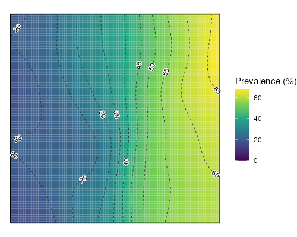
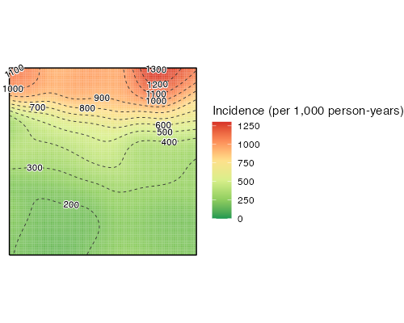

# surface-map

One R function, `surface_map()`, that turns survey data with coordinates into a smoothed geospatial surface of **prevalence**, **incidence**, a **rate** (e.g. mortality per 10,000 person-months) or a continuous **mean**, with a ggplot map.

Works on clustered data (the usual household-survey design) and on unclustered point data.

## Method

1. **Clustered data.** Each cluster gets one value. Raw values from small clusters are unstable (one positive out of two people gives "50%"), so each cluster's value is the empirical-Bayes prediction of a random-intercept model, `mgcv::gam(y ~ s(cluster, bs = "re"), method = "REML")`, which shrinks small clusters toward the overall value. The likelihood follows `type`: binomial for prevalence, Poisson with an exposure offset for incidence and rate, Gaussian for a mean. If the model cannot be fitted (fewer than two clusters, constant outcome) the raw cluster values are used, with a message.
2. **Surface.** The values are kernel-smoothed over your polygon with `spatstat.explore::Smooth()`, each cluster weighted by its sample size (or exposure). Smoothing runs in a projected CRS; the result is returned in your polygon's CRS.

With `clustered = FALSE` every row is its own point: no shrinkage, and for incidence and rate the surface is exactly smoothed events divided by smoothed exposure.

## Use

```r
source("surface_map.R")   # loads sf, mgcv, spatstat, stars, metR, tidyverse via pacman

res <- surface_map(
  df, study_area,
  type = "prevalence", outcome = rdt_pos,
  cluster = cluster, lon = lon, lat = lat
)
res$plot

# Incidence per 1,000 person-years, red-to-green palette
res <- surface_map(
  df, study_area,
  type = "incidence", outcome = cases, exposure = person_years,
  per = 1000, unit = "per 1,000 person-years",
  palette = "rog", reverse_palette = TRUE
)

# Unclustered points
res <- surface_map(df, study_area, type = "prevalence", outcome = rdt_pos, clustered = FALSE)
```

`df` has one row per person (or household) with coordinates, an outcome and, if clustered, a cluster id; `study_area` is an `sf` polygon. The function returns a list: `plot` (ggplot), `surface` (sf grid of smoothed values), `points` (what was smoothed) and `settings`.




(Example images use synthetic data.)

## Arguments

| Argument | Default | Meaning |
|---|---|---|
| `dat`, `polygon` | | Data frame; `sf` polygon bounding the surface |
| `type` | `"prevalence"` | `"prevalence"`, `"incidence"`, `"rate"` or `"mean"` |
| `outcome` | | Unquoted column: 0/1 (prevalence), non-negative count (incidence, rate), numeric (mean) |
| `exposure` | `NULL` | Unquoted follow-up time or denominator per row; required for incidence and rate |
| `clustered`, `cluster` | `TRUE`, `cluster` | Whether rows are grouped in clusters, and the cluster-id column |
| `lon`, `lat` | `lon`, `lat` | Unquoted coordinate columns, in `data_crs` |
| `cluster_xy` | `"first"` | Cluster coordinate: first non-missing, or `"mean"` |
| `per`, `unit`, `legend_name` | by type | Legend multiplier (100, 1000, 10000, 1), wording, full title |
| `shrink` | `TRUE` | `FALSE` uses raw cluster values (ignored if unclustered) |
| `gam_method` | `"REML"` | Smoothing-parameter method for the shrinkage model; `"GCV.Cp"` is mgcv's own default and reproduces scripts that did not set one. `"REML"` usually estimates more between-cluster variance, so the surface is less shrunk |
| `smooth_weights` | by data | `"n"`, `"exposure"` or `"none"` |
| `sigma` | `NULL` | Kernel bandwidth in `work_crs` units (metres for 3857); `NULL` = cross-validated |
| `data_crs`, `work_crs` | 4326, 3857 | Coordinate CRS; projected CRS used for smoothing |
| `palette`, `reverse_palette` | `"viridis"`, `FALSE` | `"rog"` or any viridis option |
| `zero_floor`, `fill_limits` | `TRUE`, `NULL` | Floor the colour scale at 0; or give `c(min, max)` to share a scale across panels |
| `contours`, `contour_labels`, `contour_binwidth` | `TRUE`, `TRUE`, `NULL` | Dashed contour lines, their labels, bin width |
| `boundary_linewidth` | `0.5` | Polygon outline width |

## Notes

- Very flat surfaces (clusters barely differ, so shrinkage pulls everything to the overall value) cannot be contoured; ggplot warns and omits the lines.
- Unclustered surfaces use a narrow cross-validated bandwidth and look noisy; set `sigma` for a smoother result.
- Needs R >= 4.1 and the packages above.

## Licence

MIT.
